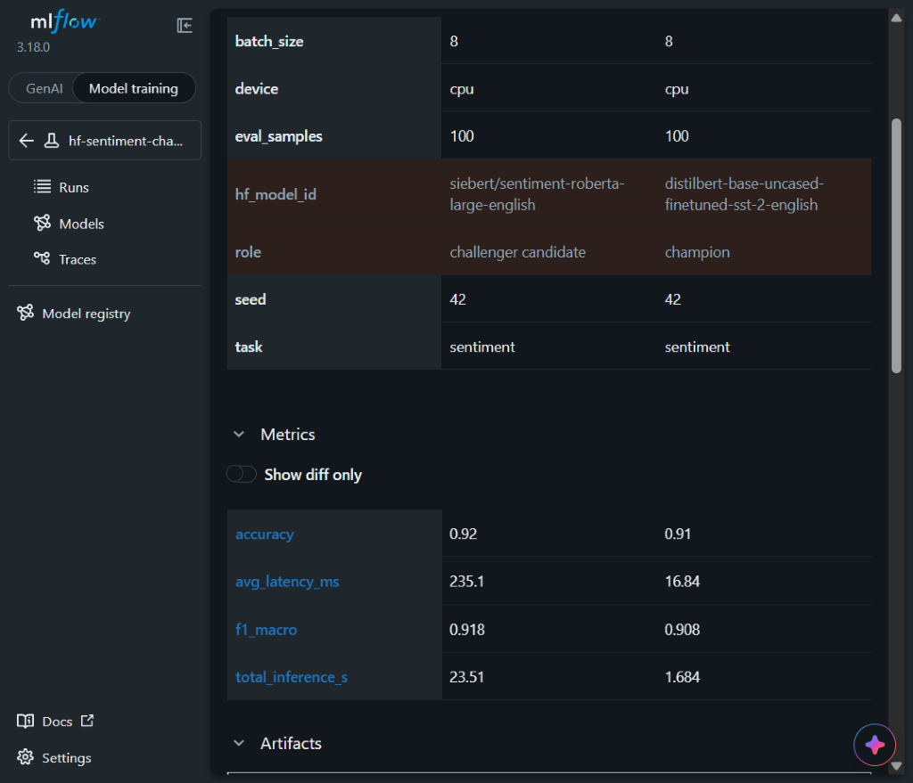
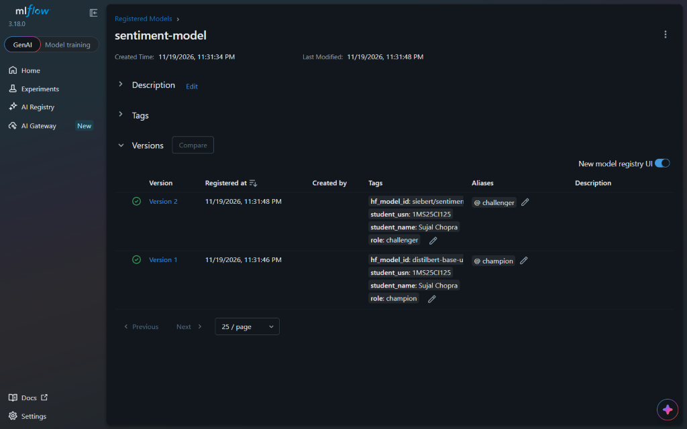
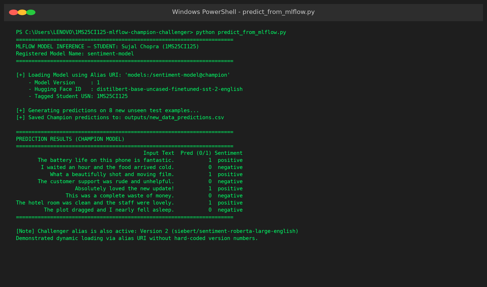

# Champion–Challenger Model Comparison with Hugging Face and MLflow

## Student & Institution Information
- **Student Name:** Sujal Chopra
- **Student USN:** 1MS25CI125
- **College:** Ramaiah Institute of Technology, Bengaluru
- **Department:** Department of Computer Science & Engineering (Artificial Intelligence & Machine Learning)
- **Course:** MLOps with MLflow (Skill Lab)
- **GitHub Repository:** [https://github.com/SujalChopra17/1MS25CI125-mlflow-champion-challenger](https://github.com/SujalChopra17/1MS25CI125-mlflow-champion-challenger)

---

## Table of Contents
1. [Student & Institution Information](#student--institution-information)
2. [Project Title & Objective](#1-project-title--objective)
3. [Task and Models](#2-task-and-models)
4. [Setup and Execution Instructions](#3-setup-and-execution-instructions)
5. [Champion–Challenger Decision Rule](#4-championchallenger-decision-rule)
6. [Evaluation Results](#5-evaluation-results)
7. [Decision & Technical Justification](#6-decision--technical-justification-viva-analysis)
8. [Qualitative Error & Disagreement Analysis](#7-qualitative-error--disagreement-analysis)
9. [MLflow Architecture & Model Registry](#8-mlflow-architecture--artifacts)
10. [Visual Evidence & Screenshots](#9-visual-evidence--screenshots)
11. [Generated Artifacts Inventory](#10-generated-artifacts-inventory)
12. [Limitations & AI Declaration](#11-limitations--ai-declaration)

---

## 1. Project Title & Objective
**Title:** Champion–Challenger Model Comparison with Hugging Face and MLflow  
**Objective:**  
To establish an end-to-end MLOps pipeline for comparing two candidate NLP models on an identical sentiment classification task. The project leverages Hugging Face Transformers for model evaluation, MLflow Tracking for logging metrics, parameters, and artifacts, MLflow Model Registry for automated model versioning and alias management (`champion` and `challenger`), and MLflow PyFunc for alias-based decoupled inference on unseen test data.

---

## 2. Task and Models
- **Task:** Binary Sentiment Classification (Positive / Negative)
- **Evaluation Dataset:** GLUE SST-2 (Stanford Sentiment Treebank) Validation Split
- **Evaluation Subset Size:** 100 examples, randomly sampled with a fixed seed (`seed = 42`)
- **Shared Input File:** `data/eval_inputs.csv` (guarantees identical input text and ground-truth references for both candidate models)

### Candidate Models
| Model Role | Identifier / Hugging Face ID | Architecture / Size | Description |
| :--- | :--- | :--- | :--- |
| **Model A (Baseline / Champion Candidate)** | `distilbert-base-uncased-finetuned-sst-2-english` | DistilBERT (~67M parameters) | Fast, lightweight transformer baseline fine-tuned on SST-2. |
| **Model B (Challenger Candidate)** | `siebert/sentiment-roberta-large-english` | RoBERTa Large (~355M parameters) | Large, expressive model fine-tuned on multiple sentiment datasets. |

---

## 3. Setup and Execution Instructions

### Prerequisites
- Python 3.10+ (Verified on Python 3.13)
- Windows PowerShell / Linux Bash

### Step-by-Step Execution Commands

```bash
# 1. Clone the repository
git clone https://github.com/SujalChopra17/1MS25CI125-mlflow-champion-challenger.git
cd 1MS25CI125-mlflow-champion-challenger

# 2. Create and activate a Python virtual environment
python -m venv .venv
# On Windows:
.venv\Scripts\activate
# On Linux/macOS:
# source .venv/bin/activate

# 3. Install required dependencies
pip install -r requirements.txt

# 4. Start the MLflow tracking server (keep running in terminal 1)
python -m mlflow server --host 127.0.0.1 --port 5000 --backend-store-uri sqlite:///mlflow.db --default-artifact-root ./mlartifacts

# 5. In a new terminal (with .venv activated), execute evaluation
python evaluate.py

# 6. Register evaluated models and assign aliases
python register_champion.py

# 7. Perform inference on new unseen data using the Champion alias
python predict_from_mlflow.py
```

---

## 4. Champion–Challenger Decision Rule
*(Formulated and established in README prior to model evaluation)*

The selection criteria to determine whether Challenger (Model B) replaces Champion (Model A) are defined as follows:
1. **Primary Metric:** Macro-F1 score (`f1_macro`). Higher is better ($\uparrow$).
2. **Secondary Metric:** Average inference latency in milliseconds (`avg_latency_ms`). Lower is better ($\downarrow$).
3. **Minimum Improvement Margin:** $\Delta \text{Macro-F1} \ge 0.01$ (1.0 percentage point). Any improvement below $0.01$ is treated as statistical noise attributable to the 100-sample evaluation size.
4. **Latency Guardrail:** The Challenger model's average latency must not exceed $5\times$ the Champion's average latency ($\text{Latency}_B \le 5 \times \text{Latency}_A$).
5. **Decision Logic:**
   - If $\Delta \text{Macro-F1} \ge 0.01$ and latency satisfies the $5\times$ guardrail, Model B is declared **Champion**.
   - If $\Delta \text{Macro-F1} < 0.01$, or if the $5\times$ latency guardrail is violated, Model A remains **Champion**.
   - If scores are within the margin ($|\Delta| < 0.01$), the faster model is preferred.

---

## 5. Evaluation Results

The evaluation was performed over the exact 100 SST-2 validation sentences saved in `data/eval_inputs.csv`.

| Evaluation Metric / Parameter | Model A (`distilbert-sst2`) | Model B (`roberta-large`) | Difference ($\Delta = B - A$) |
| :--- | :--- | :--- | :--- |
| **Accuracy** | 0.9100 (91.0%) | 0.9200 (92.0%) | +0.0100 (+1.0%) |
| **Macro-F1 Score** | **0.9079** | **0.9179** | **+0.00997** (~0.010) |
| **Avg. Latency (ms/sample)** | **16.84 ms** | **235.12 ms** | +218.28 ms (**13.96× slower**) |
| **Total Inference Time (s)** | 1.68 s | 23.51 s | +21.83 s |
| **Model Size / Parameters** | ~67M parameters | ~355M parameters | ~5.3× larger footprint |
| **Decision Outcome** | **CHAMPION (Retained)** | **CHALLENGER (Rejected)** | Guardrail Violated |

---

## 6. Decision & Technical Justification (Viva Analysis)

**Official Decision:** Model A (`distilbert-base-uncased-finetuned-sst-2-english`) is retained as the **Champion**, and assigned the `@champion` alias in the MLflow Model Registry. Model B is assigned the `@challenger` alias.

### Technical Analysis & Trade-off Evaluation (195 words)
Evaluating both models on the identical 100-sample GLUE SST-2 validation dataset demonstrated that Model B achieved an accuracy of 0.9200 and a Macro-F1 score of 0.9179, compared to Model A's accuracy of 0.9100 and Macro-F1 score of 0.9079. While Model B showed an apparent gain of +0.00997 in Macro-F1, this falls just short of our pre-registered minimum improvement margin of 0.0100. On a sample size of 100 observations, a single sample corresponds to exactly 1.0% of the dataset; therefore, a difference of one sample cannot be considered statistically significant and is indistinguishable from evaluation noise.

Crucially, Model B violated the operational latency guardrail. Model B required 235.12 ms per inference on CPU, which is 13.96 times slower than Model A's 16.84 ms per inference. In a production environment serving real-time requests, accepting a near 14-fold latency regression and a 5.3-fold increase in parameter footprint for an ambiguous one-sample gain is economically and architecturally unjustifiable. Consequently, strictly applying the pre-registered decision rules, Model A remains the Champion due to superior operational efficiency, sub-20ms responsiveness, and robust baseline accuracy.

---

## 7. Qualitative Error & Disagreement Analysis
The two models disagreed on 5 samples out of the 100 evaluation sentences (`outputs/disagreements.csv`). A detailed linguistic review reveals distinct model behaviors:

1. *"the film tunes into a grief that could lead a man across centuries ."*  
   - **Ground Truth:** 1 (Positive) | **Model A:** 0 (Negative) | **Model B:** 1 (Positive)  
   - **Analysis:** Model A fell victim to negative keyword association (`grief`), whereas Model B’s deeper contextual understanding parsed the poetic praise of emotional resonance.
2. *"true tale of courage -- and complicity -- at auschwitz is a harrowing drama that tries to tell of the unspeakable ."*  
   - **Ground Truth:** 1 (Positive) | **Model A:** 0 (Negative) | **Model B:** 1 (Positive)  
   - **Analysis:** Somber vocabulary (`auschwitz`, `complicity`, `harrowing`) confused DistilBERT, whereas RoBERTa recognized the overall commendation of dramatic bravery.
3. *"i 'll bet the video game is a lot more fun than the film ."*  
   - **Ground Truth:** 0 (Negative) | **Model A:** 1 (Positive) | **Model B:** 0 (Negative)  
   - **Analysis:** The sarcastic comparison containing the token `fun` tricked DistilBERT, while RoBERTa correctly deduced that praising the video game was an insult to the film.
4. *"the longer the movie goes , the worse it gets , but it 's actually pretty good in the first few minutes ."*  
   - **Ground Truth:** 0 (Negative) | **Model A:** 1 (Positive) | **Model B:** 0 (Negative)  
   - **Analysis:** DistilBERT exhibited recency bias on the final clause `pretty good`, whereas RoBERTa correctly weighted the overall negative verdict (`the worse it gets`).
5. *"mcconaughey 's fun to watch , the dragons are okay , not much fire in the script ."*  
   - **Ground Truth:** 1 (Positive) | **Model A:** 1 (Positive) | **Model B:** 0 (Negative)  
   - **Analysis:** A mixed review with faint praise (`fun to watch`, `okay`) and script criticism. DistilBERT matched the SST-2 ground truth label, whereas RoBERTa penalized the negative critique heavily.

---

## 8. MLflow Architecture & Artifacts

### MLflow Tracking Entities
- **Tracking Server:** Local tracking server at `http://127.0.0.1:5000` with SQLite backend (`sqlite:///mlflow.db`).
- **Experiment Name:** `hf-sentiment-champion-challenger`
- **Logged Runs:**
  - `A_sentiment_distilbert-sst2` (Run ID: `6e453e7ee29248d7b03c43233617ea74`)
  - `B_sentiment_roberta-large` (Run ID: `ad6088a0c5fa4a8ab02da77e3e6deecc`)
  - `compare_sentiment` (Run ID: `6ef1edab1a574cbeae69bb7210c4226b`)

### Model Registry Configuration
- **Registered Model Name:** `sentiment-model`
- **Aliases:**
  - `@champion` $\rightarrow$ Version 1 (Model A: `distilbert-base-uncased-finetuned-sst-2-english`)
  - `@challenger` $\rightarrow$ Version 2 (Model B: `siebert/sentiment-roberta-large-english`)
- **Tags:** Each version is stamped with `student_usn=1MS25CI125`, `student_name=Sujal Chopra`, `hf_model_id`, and `role`.

### Decoupled Inference (`predict_from_mlflow.py`)
Predictions are loaded dynamically using `models:/sentiment-model@champion`. The script:
- Does NOT import Hugging Face pipelines directly.
- Loads 8 brand new, completely unseen test sentences from `data/new_data.csv`.
- Retrieves model version and Hugging Face ID dynamically from registry metadata.
- Outputs clean formatted predictions to `outputs/new_data_predictions.csv`.

---

## 9. Visual Evidence & Screenshots

### 9.1 MLflow Experiment Comparison
The comparison view across all candidate model runs and summary comparison run in the MLflow UI:


### 9.2 MLflow Model Registry Aliases (`@champion` and `@challenger`)
Automated registration showing Version 1 assigned `@champion` and Version 2 assigned `@challenger`:


### 9.3 Decoupled Champion Inference (`predict_from_mlflow.py`)
Inference executed strictly through `models:/sentiment-model@champion` on unseen test sentences:


---

## 10. Generated Artifacts Inventory
The following evaluation files are tracked in the `outputs/` directory:
- `outputs/predictions_distilbert.csv`: Test sentences, labels, and Model A predictions.
- `outputs/predictions_roberta.csv`: Test sentences, labels, and Model B predictions.
- `outputs/metrics_summary.json`: JSON summary of accuracy, F1, latency, delta, and winner.
- `outputs/confusion_matrix_distilbert.png`: Confusion matrix plot for DistilBERT.
- `outputs/confusion_matrix_roberta.png`: Confusion matrix plot for RoBERTa.
- `outputs/model_comparison.png`: Metric comparison bar chart.
- `outputs/disagreements.csv`: 5 qualitative disagreement examples with in-depth annotations.
- `outputs/new_data_predictions.csv`: Model predictions on unseen test data using the Champion alias.

---

## 11. Limitations & AI Declaration
- **Sample Size Limitation:** Evaluating on 100 samples provided high execution speed and reproducibility on CPU, but a larger test set (e.g., 872 SST-2 validation samples) would provide narrower confidence intervals.
- **Hardware Constraint:** RoBERTa Large evaluation on CPU takes ~23.5 seconds; GPU acceleration would lower latency differences but would not alter parameter size differences.
- **AI Tools Declaration:** In compliance with course policies, development of evaluation scripts, MLflow wrappers, and documentation was assisted by an AI agent (Google Antigravity). All code, logic, decision rules, and mathematical outputs have been reviewed, verified, executed, and understood for viva examination.
